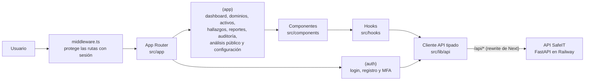

# SafeIT Front - Arquitectura

El front nunca llama al backend directamente. Todas las peticiones van a `/api/*` y Next las reenvía a la API definida en `API_URL`, así la cookie de refresh es del mismo origen y no hace falta CORS. El archivo `middleware.ts` protege las rutas del grupo `(app)` y el cliente de `src/lib/api` está tipado a partir del `openapi.json` del backend.

## Más información

- [About](ABOUT.md)
- [README](README.md)
