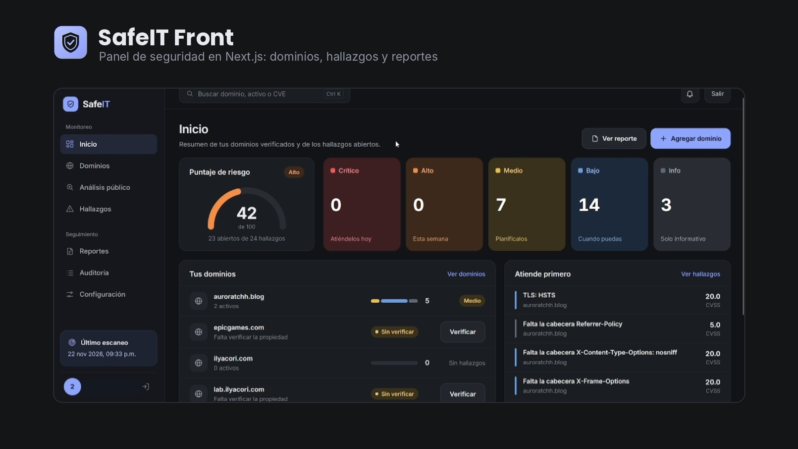

# safeit-front

<p align="center">
  
</p>



| Recurso | Ruta en el repositorio | URL |
|---|---|---|
| Logo | `/logo.png` | https://raw.githubusercontent.com/Ilyavosky/safeit-front/main/logo.png |
| Vista previa | `/preview.png` | https://raw.githubusercontent.com/Ilyavosky/safeit-front/main/preview.png |

Frontend de **SafeIT**: Next.js (App Router), TypeScript y Tailwind CSS.

## Cómo correrlo

```bash
cp .env.example .env.local
npm install
npm run dev
```

El front llama siempre a `/api/*` y Next lo reenvía al backend indicado en `API_URL` (por defecto `http://localhost:8000`). Así la cookie de refresh es del mismo origen y no hace falta CORS.

Para desarrollo local el backend debe correr con `REFRESH_COOKIE_PATH=/api/auth`.

## Despliegue

- `API_URL` se lee al construir la imagen: pásala como variable de build (`ARG API_URL` en el `Dockerfile`).
- En el backend: `REFRESH_COOKIE_PATH=/api/auth`, `ENVIRONMENT=prod` (cookie `Secure`) y `CORS_ORIGINS` con la URL pública del front.

## Contrato con el backend

`src/lib/api/schema.d.ts` se genera desde `openapi.json` del backend:

```bash
npx openapi-typescript ../back/openapi.json -o src/lib/api/schema.d.ts
```

El access token vive solo en memoria; el refresh token es una cookie `HttpOnly` del backend. Las rutas protegidas usan la cookie auxiliar `safeit_session` solo para redirigir; la autorización real la hace siempre el backend.
